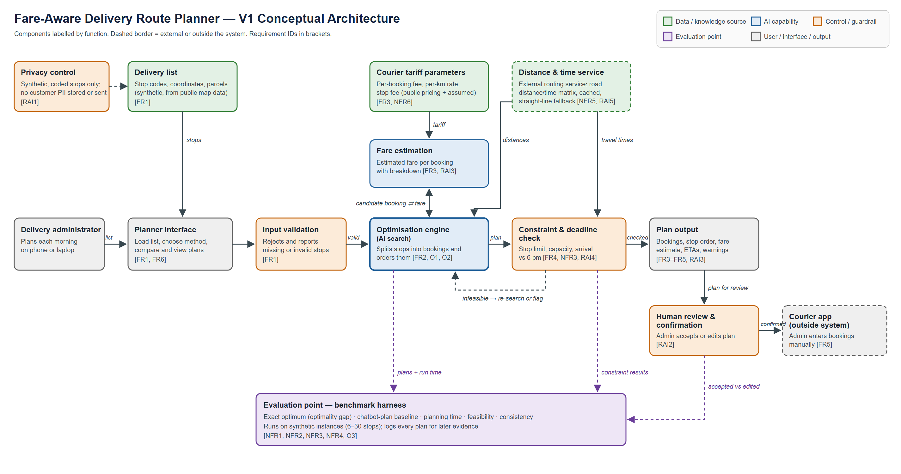

# V1 Architecture, Decisions and Traceability — Fare-Aware Delivery Route Planner

**Course:** SAIA3113 AI Engineering · Topic 2 Lab, Part C
**Student:** Mohamad Khamsah bin Mohamad Nafis (A24AI0047)
**Version:** 1.0 (Week 2) · Diagram: [`week2_architecture_v1.png`](week2_architecture_v1.png)

Flow: Requirements → Evaluation Criteria → Architecture Needs → V1 Architecture → Architecture Decisions & Trade-offs → Traceability.
Requirement IDs refer to `docs/week2_requirements.md`; criteria refer to `docs/week2_evaluation_criteria.md`.

---

## C1 — Starting from the simplest architecture

Simplest flow: **Delivery administrator → Planner interface → Optimisation capability → Delivery plan**.

This flow can produce *a* plan, but it cannot meet several requirements on its own:

- It has no way to know what a booking costs (FR3, NFR2), because the courier's fare depends on bookings, distance and stops.
- It has no real road distances or travel times (FR2, FR4).
- Nothing guarantees that the plan respects the stop limit, capacity and deadline (FR4, NFR3).
- Nothing keeps a person in control of paid bookings (RAI2).
- There is no way to prove the plan is good (O3, NFR1–NFR4).

The components below were added only to meet those needs.

## C2 — Architecture needs from the requirements

| Requirement ID | What does the requirement need? | Architecture Response |
|---|---|---|
| FR3 / NFR2 / NFR6 / RAI3 | Plans must be compared on the courier's fare, with a breakdown, and tariff changes must not need code changes. | **Fare estimation** component fed by a separate **courier tariff parameters** source (configuration). |
| FR2 / FR4 / NFR5 / RAI5 | The optimiser and deadline check need road distances and travel times, within free usage, with a visible fallback. | **Distance & time service** (external routing service, matrix cached once per instance, straight-line fallback marked as such). |
| FR2 / O1 / O2 | Stops must be split into bookings and ordered from the depot. | **Optimisation engine** (AI search: exact, nearest neighbour + 2-opt, genetic algorithm). |
| FR4 / NFR3 / RAI4 | Every plan must respect the stop limit, capacity and deadline, or be flagged. | **Constraint & deadline check** after the optimiser, with a loop back to re-search or flag. |
| FR1 | Invalid stops must be rejected and reported. | **Input validation** control before planning. |
| RAI1 | No customer PII in the repository or in external calls. | **Privacy control**: synthetic, coded stops only; only coordinates go to the routing service. |
| FR5 / RAI2 | The system recommends; a person books. | **Human review & confirmation**, with booking done manually in the **courier app**, outside the system boundary. |
| O3 / NFR1–NFR4 | Plan quality, time, feasibility and consistency must be measurable. | **Evaluation point**: a benchmark harness with the exact optimum and a chatbot-plan baseline. |

## C3 — V1 conceptual architecture

Components are labelled by function, not technology. Specific choices (which routing service, which solver library, notebook or web interface) are left to later topics.

## C4 — Architecture Decision Record

| Decision | Requirement / Constraint | Alternatives Considered | Selected Option | Trade-off Accepted |
|---|---|---|---|---|
| **AD1 · How the fare is estimated** | FR3, NFR2, NFR6; constraint: the courier's base fee is not published and no real fare data may be committed publicly. | (a) Use distance as the cost; (b) train a machine-learning fare model on receipts; (c) a configurable tariff function (per-booking fee + per-km rate + stop fee). | **(c) Configurable tariff function**, with parameters in one configuration file. A learned model is deferred to the Final Year Project, where company data can be used privately. | Estimates may differ from real fares until the parameters are calibrated, but the cost is transparent, explainable and needs no private data. Distance alone was rejected because it ignores the per-booking and per-stop charges that decide the split. |
| **AD2 · How plans are searched** | NFR2, NFR4, evaluation focus (compare with chatbot and optimum); evidence that LLMs degrade as optimisers. | (a) Ask a language model to plan (current practice); (b) only an off-the-shelf solver; (c) own AI search methods with an exact method as reference. | **(c) Exact search for up to ~10 stops as ground truth, plus nearest neighbour + 2-opt and a genetic algorithm** for larger days. An off-the-shelf solver may be added later as a benchmark. | More implementation work, and the exact method does not scale beyond small days, so heuristics are needed. In return, every plan has a measurable optimality gap and is reproducible with a fixed seed. |
| **AD3 · Who places the booking** | RAI2, FR5; constraint: bookings cost real money; the course avoids autonomous decision-making systems. | (a) Book automatically through the courier's API; (b) recommend a plan and let the administrator book manually. | **(b) Recommend only.** The plan ends at human review; the courier app sits outside the system boundary. | The administrator still types the stops into the courier app (time cost), but the system can never spend money or book the wrong thing. API booking is left to the Final Year Project, behind a confirmation step. |
| **AD4 · Where distances come from** | FR2, FR4, NFR5, RAI5; constraint: free usage limits. | (a) Straight-line distance × road factor; (b) an external routing service on every evaluation; (c) external routing service, matrix cached once per instance, straight-line fallback. | **(c) Cached routing matrix with a marked fallback.** | Depends on an external service and its availability; cached matrices can become stale if roads change. A fallback plan is less accurate and is labelled so (RAI5). |
| **AD5 · Where constraints are enforced** | FR4, NFR3, RAI4. | (a) Trust the optimiser to respect constraints; (b) a separate check after the optimiser. | **(b) Separate constraint & deadline check** that can send a plan back for re-search or flag it. | Extra processing per plan and some duplication with the optimiser's own rules, but a single independent place that guarantees no infeasible plan is shown as feasible. |

## Initial Requirements Traceability Matrix

| Objective | Requirement | Evaluation Criterion | Architecture Element | Later Evidence |
|---|---|---|---|---|
| O1 | FR2, FR4, NFR3 | Constraint compliance (100% feasible or flagged) | Optimisation engine + Constraint & deadline check | Constraint-checker report over all evaluation runs (Topic on evaluation) |
| O1 | FR3, RAI3 | Plan output completeness (5/5 checklist) | Fare estimation + Plan output | Checklist results on every evaluation plan; sample plan screenshots |
| O1 | FR5, RAI2 | Scope: recommend, never book (0 bookings) | Human review & confirmation; courier app outside the boundary | Scenario test log and code review note |
| O2 | FR2, NFR4 | Consistency (100% identical outputs) | Optimisation engine (fixed random seed) | Repeated-run comparison in `evaluation/` |
| O3 | NFR2 | Plan cost quality (mean gap ≤ 5%) | Evaluation point (exact optimum) | Optimality-gap table and chart for 30 synthetic instances |
| O3 | FR3, NFR2 | Cost compared with chatbot plans (≥ 90% of days no worse) | Evaluation point (chatbot baseline) + Fare estimation | Paired cost comparison over 20 synthetic days |
| O3 | NFR1 | Planning time (p90 ≤ 10 s, 12 stops) | Optimisation engine; Distance & time service (cached) | Run-time log from Colab |
| — | RAI1 | Privacy (0 PII items) | Privacy control | Repository scan and routing-service payload inspection |

## Final review checklist

- **Does each major component support a requirement or evaluation need?** Yes. Every box in the diagram carries the requirement IDs it serves, and the C2 table gives the reason for each one.
- **Is any important data source, safety control or evaluation point missing?** Order data from the real order system is deliberately left out of V1 (privacy, RAI1); real courier quotations are also left out (AD1). Both are planned for the Final Year Project. No missing control was found for the V1 scope.
- **Has any technology or component been added that is not yet justified?** No. There is no language model, database or booking API in V1, because no current requirement needs one. Technologies are not named.
- **Is there a simpler architecture that could still satisfy the requirements?** The input-validation and constraint-check controls could be merged into the optimiser. They are kept separate so that feasibility is checked independently of the search method being evaluated (AD5).

## Reflection

**Which architecture decision involved the most important trade-off? Which requirement drove it, and what trade-off was accepted?**

AD1, how the fare is estimated, carries the most important trade-off. It is driven by FR3 and NFR2: plans must be compared on what the courier charges, because that is what the company pays and what decides how stops should be split. The best estimate would come from a model trained on real receipts or live courier quotations. Those data are private company records and cannot go into a public course repository. The courier's base fee is also not published. The accepted trade-off is a transparent, configurable tariff function whose numbers may differ from real fares until they are calibrated. This means every cost saving reported in this course project is a saving *under the fare model*, not a guaranteed saving in ringgit. The evaluation documents must state this clearly. The more accurate, data-driven fare model is left to the Final Year Project, where the data can be used privately.
